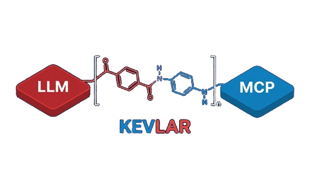

<p align="center">
  
</p>

<p align="center">
  <a href="LICENSE"></a>
  
  
  
  
  
</p>

# Kevlar

Kevlar is a proxy firewall for Model Context Protocol


```
LLM  [ KEVLAR ]  MCP
```
It sits between (you) and (everyone else)


---

## Why do I need Kevlar?

MCP servers are a blind trust problem. When you connect an MCP server to your LLM, the server controls what goes into tool descriptions — and those descriptions land in the model's context before you've seen them. A malicious or compromised server can use that to hijack the model's behavior, exfiltrate credentials through tool call arguments, or inject new tools mid-session that weren't present at handshake time.

Kevlar enforces four things the MCP spec doesn't:

- **Tool descriptions never reach the LLM** — stripped unconditionally. The model can't be manipulated through text it never sees.
- **Tool call responses are scanned** — ~60 indicators sourced from published injection research. Matched content is redacted or the entire response is blocked before the model reads it.
- **Credential exfiltration is blocked at egress** — even if the model is already compromised, the outbound call never reaches the server.
- **Tool registry is locked after handshake** — the server can't inject new tools mid-session.

You don't control what MCP servers put in their messages, and LLMs are trivially manipulated by text. Kevlar enforces a policy layer between them so you don't have to trust every server you connect to.

---

## How it works

<details>
<summary>TL;DR</summary>

Kevlar sits between client and server and does four things:

1. Strips all tool descriptions before they reach the LLM. No exceptions.
2. Scans tool call responses for injection payloads and either redacts matched spans or blocks the response entirely.
3. Blocks outbound calls carrying credentials in their arguments, even if the LLM has already been compromised.
4. Locks the tool registry after the initial handshake so the server cannot inject new tools mid-session.

</details>

<details>
<summary>CDR on <code>tools/list</code></summary>

Kevlar strips every `description` field to `""` unconditionally on every `tools/list` response, before the message reaches the client. The LLM sees `name` and `inputSchema` only. `inputSchema` is rebuilt from an allowlist: prose fields like `description`, `title`, `examples`, and `$comment` are stripped there too, and `enum` values, property keys, `$ref` targets, and `type` values are validated against the MCP spec. Score 0 on this pass cannot be achieved by adding description text back, because description text is never forwarded regardless of score.

</details>

<details>
<summary>Analysis on <code>tools/call</code> responses</summary>

Tool call results cannot be stripped without breaking functionality. Kevlar scans them against ~60 indicators sourced from published prompt injection research. Responses scoring above the mode threshold are quarantined (matched spans replaced with `[KEVLAR:<ID>]` tokens) or rejected (replaced with an `isError` block). Unicode bypass attempts using characters that normalize to injection text under NFKC are detected before normalization and redacted after.

</details>

<details>
<summary>Egress DLP</summary>

Outbound `tools/call` arguments are scanned before the call is forwarded to the server. If the LLM has already been compromised and is trying to exfiltrate credentials, the call is blocked at the proxy layer. The server never receives it. Runs in all three modes.

</details>

<details>
<summary>Tool registry lock (strict mode)</summary>

After the initial `tools/list` handshake, the set of callable tool names is frozen. `notifications/tools/list_changed` from the server is dropped, not forwarded. Any call to a tool not in the CDR-sanitized set is blocked with a synthetic `isError` response regardless of call content.

</details>

---

## Setup

<details>
<summary>Install</summary>

```bash
git clone https://github.com/Ablation-Tool/kevlar.git
cd kevlar
pip install .
```

Requires Python 3.10+. Linux and macOS only. Depends on `os.killpg` and `asyncio.connect_read_pipe`.

</details>

<details>
<summary>Quickstart</summary>

```bash
kevlar --mode strict -- npx -y @modelcontextprotocol/server-filesystem /tmp
kevlar --mode audit --log /tmp/kevlar.jsonl -- uvx mcp-server-git
```

</details>

<details>
<summary>Claude Desktop integration</summary>

In `~/Library/Application Support/Claude/claude_desktop_config.json` (macOS):

```json
{
  "mcpServers": {
    "filesystem": {
      "command": "kevlar",
      "args": [
        "--mode", "strict",
        "--log", "/tmp/kevlar-filesystem.jsonl",
        "--",
        "npx", "-y", "@modelcontextprotocol/server-filesystem",
        "/Users/you/Documents"
      ]
    }
  }
}
```

</details>

<details>
<summary>Modes</summary>

| Mode | Reject threshold | Tool registry | `list_changed` |
|------|-----------------|---------------|----------------|
| `strict` | score ≥ 40 | Locked at handshake | Dropped |
| `lenient` | score ≥ 80 | Dynamic updates allowed | Forwarded |
| `audit` | Never blocks | Dynamic | Forwarded |

Use `strict` in production. Use `audit` to profile a new server before tightening the threshold. `--log` produces a JSONL file with every policy decision, indicator ID, score, and masked value snippet.

</details>

---

## Reference

<details>
<summary>Architecture</summary>

Two files: `policy.py` is a pure CDR engine with no I/O, directly unit-testable. `kevlar.py` is the async stdio proxy. No runtime dependencies, stdlib only. `kevlar.py` spawns the server with `start_new_session=True` and kills the process group on shutdown, so `npx`/`uvx` child processes don't linger.

See [docs/architecture.md](docs/architecture.md) for the full design: proxy lifecycle, CDR pipeline per message type, scoring arithmetic, indicator registries, and audit log format.

</details>

<details>
<summary>Tests</summary>

```bash
pip install -e ".[dev]"
pytest
```

149 tests. `tests/test_proxy.py` runs integration tests against real subprocess pairs. `tests/test_policy.py` covers the pure policy engine in unit tests.

</details>

---

*The poly(p-phenylene terephthalamide) monomer. The amide linkage bridges the LLM and MCP sides exactly as the proxy bridges client and server across a locked policy boundary.*
